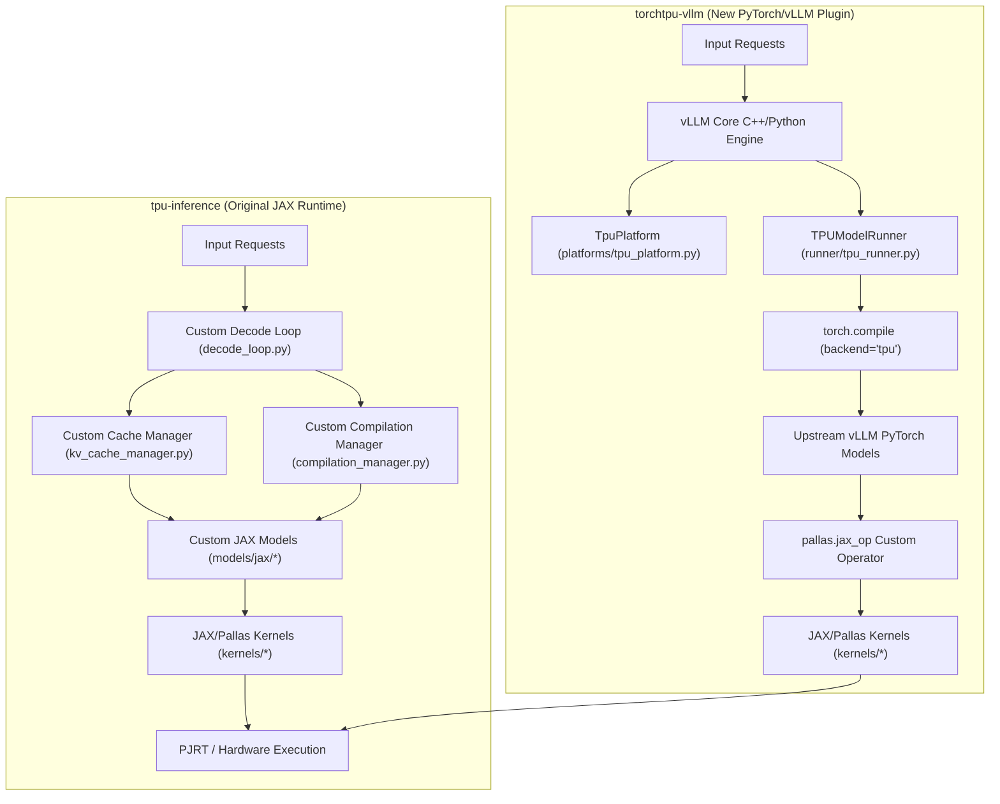

# Architectural Comparison: `tpu-inference` vs. `torchtpu-vllm`

This document provides a detailed, mechanical comparison of our original JAX-based inference engine (`tpu-inference`) and the new native PyTorch-based integration (`torchtpu-vllm`). It contrasts their core orchestration structures, model definition layers, kernel interop mechanisms, and compilation systems.

---

## 1. High-Level Architecture Overview

The fundamental design difference lies in the boundary of custom code. `tpu-inference` is a complete, custom-written inference engine implemented in JAX. `torchtpu-vllm` is a lightweight platform plugin that hooks directly into the upstream `vllm` engine, leaving all scheduling and scheduling memory management to `vllm`.

---

## 2. Core Layer Comparison

### 2.1 Orchestration & Runtime Loop
*   **`tpu-inference` (JAX Engine):**
    *   **Orchestration:** Hand-rolls all elements of a serving engine. The serving loop ([decode_loop.py](../../tpu-inference/tpu_inference/runner/decode_loop.py)) explicitly coordinates token generation steps.
    *   **Memory Management:** Paging, block allocation, and virtual token mapping are managed by a bespoke [kv_cache_manager.py](../../tpu-inference/tpu_inference/runner/kv_cache_manager.py) and [continuous_block_pool.py](../../tpu-inference/tpu_inference/runner/continuous_block_pool.py).
    *   **Request Batching:** Continuous batching and sequence padding are manually handled by [input_batch.py](../../tpu-inference/tpu_inference/runner/input_batch.py) and [persistent_batch_manager.py](../../tpu-inference/tpu_inference/runner/persistent_batch_manager.py).
*   **`torchtpu-vllm` (OOT vLLM Plugin):**
    *   **Orchestration:** Leverages upstream `vllm`'s native C++ and Python scheduler.
    *   **Memory Management:** Uses `vllm`'s core `BlockSpaceManager` and memory allocator. The [tpu_runner.py](../src/vllm_torchtpu/runner/tpu_runner.py) only implements `get_kv_cache_spec()` to describe physical page shapes and sizes to `vllm`'s allocator.
    *   **Request Batching:** Handled transparently by `vllm`'s continuous batching scheduler. The runner receives fully batched, pre-scheduled input sequences and simply drives the model forward.

### 2.2 Model Definition Layer
*   **`tpu-inference` (JAX Engine):**
    *   **Definition:** Model architectures are written from scratch in JAX under [tpu_inference/models/jax/](../../tpu-inference/tpu_inference/models/jax/). Each layer (Attention, MLP, MoE) is implemented as a custom Flax/JAX module.
    *   **Weights Loading:** Weight-loading code must manually map, transpose, and shard PyTorch weights from Hugging Face checkpoints to fit JAX's sharding meshes and layouts.
*   **`torchtpu-vllm` (OOT vLLM Plugin):**
    *   **Definition:** Contains **no custom model architecture files**. It directly loads the upstream `vllm` PyTorch model definitions.
    *   **Overrides:** Custom platform patches are applied at import time (via `apply_tpu_patches()` in [tpu_platform.py](../src/vllm_torchtpu/platforms/tpu_platform.py#L91)). These patches rebind specific class symbols (such as replacing standard attention layers with the `PallasAttentionBackend` or adjusting the expert routing loop).
    *   **Weights Loading:** Uses `vllm`'s native weight loaders. The weights are loaded into HBM and sharded across the PJRT mesh axes according to the active `ShardingConfigManager` without custom conversion scripts.

### 2.3 Pallas Kernel Interoperability
*   **`tpu-inference` (JAX Engine):**
    *   **Interop Method:** Relies on `torchax.interop` pointer casting (`jax_view` and `torch_view`) to execute functional JAX/Pallas kernels on PyTorch-XLA tensors.
    *   **Tracing Behavior:** This manual casting is opaque to the PyTorch Dynamo compiler. Dynamo cannot trace through the `jax_view`/`torch_view` boundaries, causing graph breaks and splitting the execution into multiple separate JIT compilation segments.
*   **`torchtpu-vllm` (OOT vLLM Plugin):**
    *   **Interop Method:** Uses PyTorch-XLA's native [torch_tpu._internal.pallas.jax_op](../src/vllm_torchtpu/layers/vllm/attention.py#L9) decorator.
    *   **Tracing Behavior:** The decorator registers the JAX/Pallas kernel as a native PyTorch custom operator, coupled with a "fake" meta-implementation that describes the output shapes and dtypes. Dynamo cleanly traces this operator as a single node in the graph, permitting PyTorch-XLA to compile and optimize the entire forward pass as a single, continuous HLO graph.

### 2.4 Compilation System
*   **`tpu-inference` (JAX Engine):**
    *   **Control:** A complex [compilation_manager.py](../../tpu-inference/tpu_inference/runner/compilation_manager.py) manages JAX compilation boundaries (`jax.jit`). It handles the compilation cache, shape-bucket dispatching, and dynamic shape padding.
*   **`torchtpu-vllm` (OOT vLLM Plugin):**
    *   **Control:** Implements a lean [TpuCompilerAdaptor](../src/vllm_torchtpu/compilation/tpu_compiler.py) that acts as an adapter for `vllm`'s native compilation manager.
    *   **Execution:** Graph compilation, cache lookups, and machine-code execution are offloaded to PyTorch-XLA's native compiler backend, which intercepts operations at the boundaries of our predefined static shape buckets (`compile_sizes`).

---

## 3. Directory Map Comparison

The table below maps where specific engineering functionalities reside in both repositories:

| Functionality | `tpu-inference` Location | `torchtpu-vllm` Location |
| :--- | :--- | :--- |
| **Platform Discovery** | [tpu_inference/platforms/tpu_platform.py](../../tpu-inference/tpu_inference/platforms/tpu_platform.py) | [src/vllm_torchtpu/platforms/tpu_platform.py](../src/vllm_torchtpu/platforms/tpu_platform.py) |
| **Worker Initialization** | [tpu_inference/worker/tpu_worker.py](../../tpu-inference/tpu_inference/worker/tpu_worker.py) | [src/vllm_torchtpu/worker/tpu_worker.py](../src/vllm_torchtpu/worker/tpu_worker.py) |
| **Model Forward Driver** | [tpu_inference/runner/tpu_runner.py](../../tpu-inference/tpu_inference/runner/tpu_runner.py) | [src/vllm_torchtpu/runner/tpu_runner.py](../src/vllm_torchtpu/runner/tpu_runner.py) |
| **JAX/Pallas Kernels** | [tpu_inference/kernels/](../../tpu-inference/tpu_inference/kernels/) | [src/vllm_torchtpu/kernels/](../src/vllm_torchtpu/kernels/) |
| **Attention Backend** | [tpu_inference/layers/vllm/backends/](../../tpu-inference/tpu_inference/layers/vllm/backends/) | [src/vllm_torchtpu/layers/vllm/attention.py](../src/vllm_torchtpu/layers/vllm/attention.py) |
| **Model Architectures** | [tpu_inference/models/jax/](../../tpu-inference/tpu_inference/models/jax/) | *None (Delegated to upstream `vllm` PyTorch models)* |
| **Sharding Config** | [tpu_inference/layers/common/sharding.py](../../tpu-inference/tpu_inference/layers/common/sharding.py) | [src/vllm_torchtpu/layers/common/sharding.py](../src/vllm_torchtpu/layers/common/sharding.py) |
| **Serving Scheduling** | [tpu_inference/runner/decode_loop.py](../../tpu-inference/tpu_inference/runner/decode_loop.py) | *None (Delegated to upstream `vllm` C++ Scheduler)* |
| **Cache Management** | [tpu_inference/runner/kv_cache_manager.py](../../tpu-inference/tpu_inference/runner/kv_cache_manager.py) | *None (Delegated to upstream `vllm` BlockSpaceManager)* |

---

## 4. Architectural Trade-offs & Implications

*   **Maintainability & Upstream Parity:**
    *   *JAX Engine:* High maintenance. Any new feature added to upstream `vllm` (e.g., speculative decoding variants, prefix caching, multimodal features) must be manually ported and rewritten to fit our JAX runtime and JAX model definitions.
    *   *vLLM Plugin:* Low maintenance. Because we run upstream PyTorch models and delegate orchestration to the core engine, we automatically inherit upstream `vllm` optimizations and feature updates with minimal platform-level changes.
*   **Performance & Compiler Control:**
    *   *JAX Engine:* Direct, granular control. Compiling pure JAX models via `jax.jit` provides highly predictable compilation times and direct control over compiler optimizations, XLA fusing, and memory layouts.
    *   *vLLM Plugin:* Relies on PyTorch-XLA/Dynamo tracing. Tracing complex PyTorch models can occasionally introduce compilation overheads or graph breaks if PyTorch operators are incompatible with XLA, requiring careful use of custom operator boundaries (`pallas.jax_op`) and platform-level monkey-patches.
