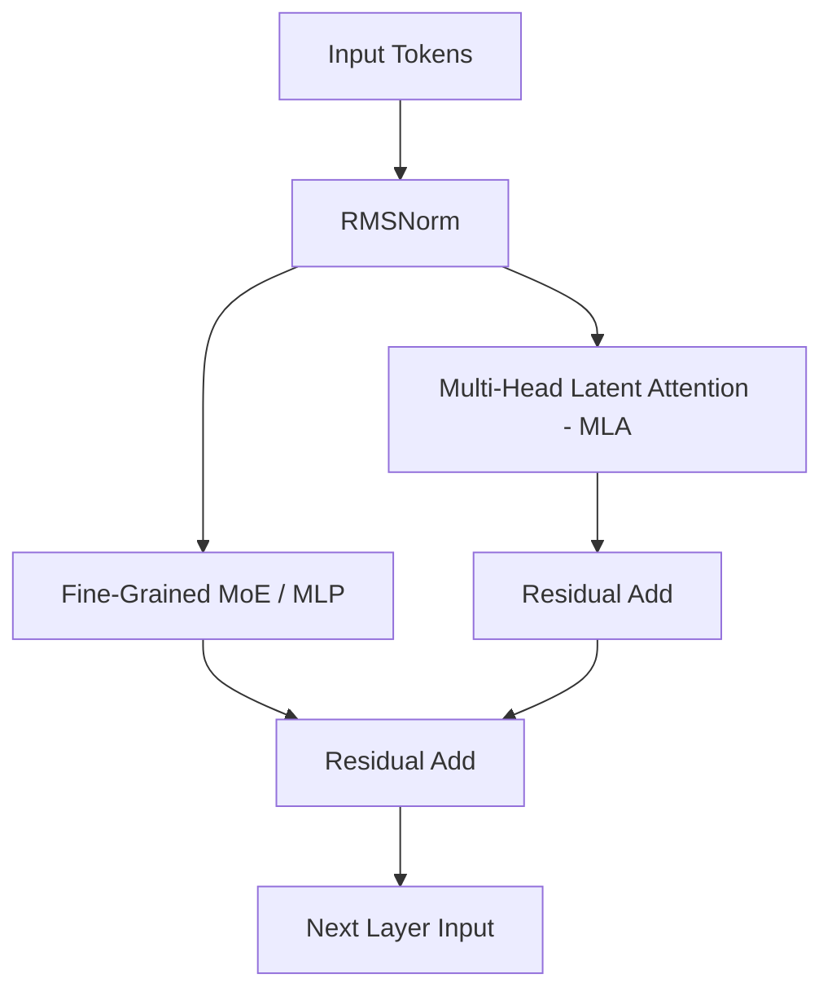
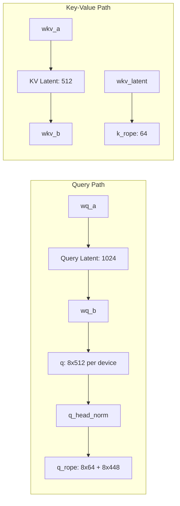
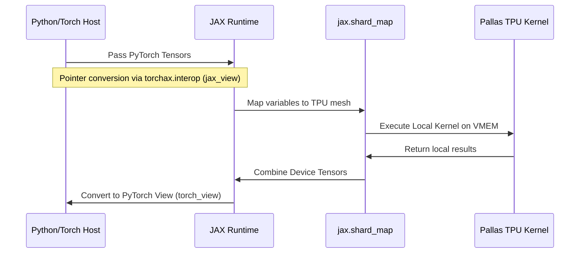
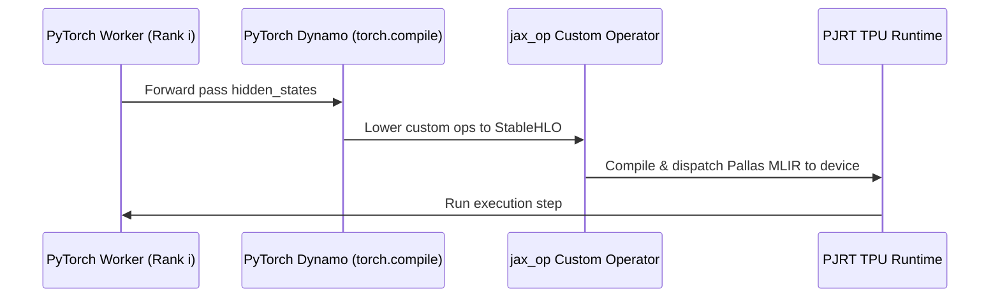

# DeepSeek-V4 TPU Architecture & Implementation Deep Dive

This document details the architecture of the DeepSeek-V4 (`deepseek-ai/DeepSeek-V4-Flash`) model and compares its native TPU execution mechanics between the JAX-based `tpu-inference` stack and the PyTorch-based `torchtpu-vllm` stack.

---

## 1. DeepSeek-V4 Architectural Overview

DeepSeek-V4 uses a highly optimized Mixture-of-Experts (MoE) transformer architecture, specializing in efficient latency and throughput via two core mechanics:
1. **Multi-Head Latent Attention (MLA):** Compresses the Key-Value (KV) cache to reduce HBM traffic.
2. **Fine-Grained Mixture-of-Experts (MoE):** Segregates routed experts and shared experts to improve parameter utilization.



### 1.1 Multi-Head Latent Attention (MLA)
Standard MHA caches $2 \times L \times n_{heads} \times d_{head}$ elements per token. For long-context generation, this creates a massive KV cache bottleneck. MLA mitigates this by compressing Key and Value states into a low-dimensional latent space:

$$\text{Compressed Cache Size: } d_c \ll n_{heads} \times d_{head}$$

For DeepSeek-V4-Flash:
- **Head Dimension ($d_{head}$):** 512
- **Decoupled RoPE Key Dimension ($d_{rope}$):** 64
- **NoPE Dimension ($d_{nope}$):** $512 - 64 = 448$
- **KV Compression Latent Rank ($d_c$):** 512
- **Query Compression Latent Rank ($d_{qr}$):** 1024
- **Grouped Attention Groups ($g$):** 8 (Grouped-Query Attention with groups)



During attention, the query uses standard RoPE, while the compressed KV cache avoids decompressing the full Key tensor by performing a modified projection. Key position information is instead added via a decoupled 64-dimensional Key RoPE vector $k^R_t$ appended to the latent cache.

### 1.2 Fine-Grained Mixture-of-Experts (MoE)
DeepSeek-V4 separates experts into:
- **Shared Experts:** Always active, acting as a global FFN to capture common facts.
- **Routed Experts:** Activated dynamically via Top-K routing.
- **Hash-Routed Experts:** Active on specific layers, routing tokens based on token ID hashes to bypass the router GEMM entirely.

---

## 2. JAX Stack Execution Mechanics (`tpu-inference`)

In `tpu-inference`, the model is executed under JAX as a single SPMD (Single Program, Multiple Data) execution graph:



### 2.1 SPMD Orchestration
- Uses `jax.shard_map` to partition sequence/batch dimensions along the TPU mesh axes (`ShardingAxisName.ATTN_DATA` and `ShardingAxisName.BATCH`).
- Interoperability with PyTorch models is achieved via `torchax.interop` (`jax_view` and `torch_view`), which performs zero-copy pointer exchanges.

### 2.2 The JAX Compressor Cache Overlay Invariant
In `tpu-inference`, the custom Pallas compressor kernel expects the Compressor State Cache and the Sliding Window Attention (SWA) cache to reside in the **same physical memory block**. This is enforced by mapping both cache names to the same underlying cache index:

```python
# In tpu-inference/tpu_inference/runner/kv_cache_manager.py
if self.shared_kv_cache_layers:
    for layer_name, target_layer_name in self.shared_kv_cache_layers.items():
        self.runner.layer_name_to_kvcache_index[layer_name] = \
            self.runner.layer_name_to_kvcache_index[target_layer_name]
```

At runtime, this ensures `assert state_cache_index == cache_index` holds, preventing memory corruption and allowing the compressor to write intermediate states directly into the SWA cache pages.

---

## 3. PyTorch Stack Execution Mechanics (`torchtpu-vllm`)

In `torchtpu-vllm`, execution shifts from single-controller JAX SPMD to a multi-process execution model (MPMD) using PyTorch-XLA:



### 3.1 Traceable Custom Operators via `jax_op`
To prevent PyTorch's Dynamo compiler from hitting graph breaks, Pallas kernels are registered as native custom operators using `torch_tpu._internal.pallas.jax_op`.
- This requires registering a fake tensor implementation (`register_fake`) to tell the compiler the output shape and dtype during symbolic FX graph tracing.

### 3.2 Lazy Memory Allocation & `profile_run`
Unlike JAX, which pre-allocates static memory buffers, `torchtpu-vllm` uses a lazy allocation scheme:
1. Runs a dummy forward pass (`profile_run`) at the maximum configured batch size.
2. Traces the peak activation and weight memory footprint.
3. Allocates the remaining HBM to the vLLM Paged KV Cache.
4. If weights are uncompressed, or if the compiler generates long PyTorch view chains, `profile_run` spikes memory usage, leaving no HBM for the KV cache.

### 3.3 MoE Expert CPU Requantization & Disk Serialization Cache
FP8 MoE weights are too large to fit in host/device memory during the compilation phase:
- **Solution:** Requantize the FP8 expert weights to FP4 block-512.
- **CPU Execution:** Requantization is computed on the CPU host to avoid TPU HBM allocation spikes. The results are loaded into contiguous TPU parameters.
- **Serialization Cache:** To prevent a ~64 minute startup delay on GKE, pre-quantized shards are serialized to disk inside the `VLLM_FP4_CACHE_DIR` and loaded instantly in subsequent runs.

### 3.4 Sinking Attention Rank-Slicing
The `attention_sinks` parameter is declared globally with shape `[64]`. Since the custom Pallas op partitions tensors using the mesh spec `P(shard_axis)`, passing the global `attention_sinks` tensor directly causes a tracer shape mismatch. It must be sliced in PyTorch prior to invocation:

```python
local_sink = self.attn_sink[rank * n_local_heads : (rank + 1) * n_local_heads].clone()
```

---

## 4. Architectural Differences and Porting Challenges

| Architectural Component | JAX Reference (`tpu-inference`) | PyTorch Target (`torchtpu-vllm`) | Mechanical Impact |
| :--- | :--- | :--- | :--- |
| **Execution Paradigm** | Single-process JAX program (SPMD) | Multi-process PyTorch runtime (MPMD) | Requires explicit rank coordination and collective ops. |
| **Pallas Integration** | Pointer views via `torchax.interop` | `torch_tpu._internal.pallas.jax_op` wrappers | Custom ops must be fully traceable in Dynamo without graph breaks. |
| **KV Cache Allocation** | Pre-allocated compile-time layouts | Dynamic allocation via `profile_run` | View fragmentation or memory spikes can block cache initialization. |
| **Cache Sharing** | Unified mapping of layers to identical indexes | Distinct cache layers managed by vLLM block allocator | Mismatched block tables can corrupt KV cache values. |
| **RoPE Application** | Handled natively inside JAX kernels | Handled explicitly in PyTorch wrapper | RoPE alignment must be inverted correctly prior to output projection. |

---

## 5. Summary of Debugged Gotchas

1. **Incorrect Slicing / Squeezing:** JAX is strict and crashes on `jnp.squeeze` if dimensions are not exactly size 1, whereas PyTorch is silent. Redundant squeezes in wrappers were purged.
2. **Lexical Variable Scoping:** Background thread compilation of helper functions inside JAX/Pallas kernels threw `UnboundLocalError`. They are now explicitly bound/redefined locally.
3. **Double Backend Registration Conflict:** Importing JAX/torchax within a PyTorch-XLA process registers the `jax` device backend, which conflicts with `torchtpu`'s backend registration and throws a `RuntimeError`. All imports of `torchax` must be avoided on the PyTorch runtime path.

---

## 6. PyTorch-XLA HBM Memory Design Patterns

To prevent physical HBM memory OOMs, allocation spikes, and fragmentation by construction, PyTorch-XLA model implementations should adhere to the following design patterns:

### 6.1 Direct-Device Tensor Allocation
* **Anti-Pattern:** Initializing tensors on CPU host memory and transferring them to TPU device using `.to(device)` in loops or lazy execution paths.
* **Why it fails:** PyTorch-XLA queues CPU-to-TPU transfers as lazy operations in XLA graph. On execution, PJRT attempts to allocate transfer buffers for all layers simultaneously, causing a massive memory allocation spike.
* **Pattern:** Always allocate tensors directly on the target XLA device:
  ```python
  tpu_kv_cache = torch.zeros(kv_cache_shape, dtype=dtype, device=self.device)
  ```

### 6.2 Pre-Compiling and Warming Up Collectives
* **Anti-Pattern:** Compiling communication kernels (such as Distributed All-Reduce) dynamically at step 1 (lazy compilation) after model parameters and KV caches have already been allocated.
* **Why it fails:** Loading a compiled communication program requires a large contiguous block of memory (e.g. 1.50GB). If the KV caches are allocated first, they fragment the HBM. When JIT compilation triggers, PJRT cannot find a contiguous block, throwing a `RuntimeProgramAllocationFailure` (fragmentation OOM) even if total free space is high.
* **Pattern:** Disable eager mode (`VLLM_ENFORCE_EAGER=0`) to enable graph compilation. During the `profile_run` (before KV Cache allocation), run a dummy step to pre-compile and load all collectives and custom ops.

### 6.3 Explicit Execution Barriers (`xm.mark_step`)
* **Anti-Pattern:** Relying on Python garbage collection to automatically clean up intermediate TPU memory buffers inside weights loading loops.
* **Why it fails:** In PyTorch-XLA, device memory allocated for temporary/intermediate graph variables is only released when a step barrier executes. Without barriers, intermediate compile memory accumulates, triggering an HBM OOM.
* **Pattern:** Insert explicit synchronization barriers and garbage collection loops after loading major components (such as each layer's weights):
  ```python
  del temp_buffer
  gc.collect()
  xm.mark_step()
  ```
