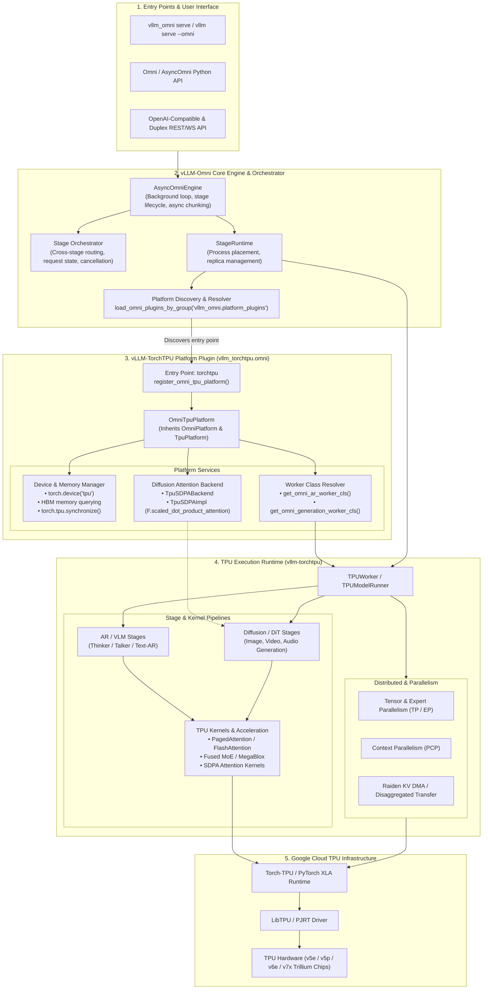
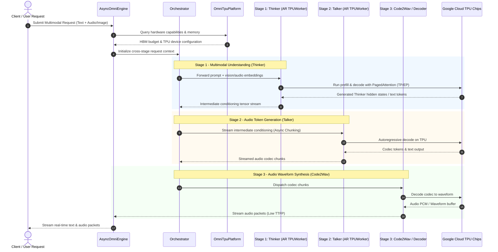

# vLLM-Omni on Google Cloud TPU Architecture & Design

This document details the end-to-end architecture, platform plugin integration, and multi-stage request execution flow for running **vLLM-Omni** models on **Google Cloud TPUs** using **`vllm-torchtpu`**.

---

## 🏗️ 1. End-to-End System Architecture

---

## 🔄 2. Multi-Stage Request Execution Lifecycle

The sequence diagram below illustrates how an end-to-end omni request (such as **Qwen3-Omni**: *Multimodal Audio/Vision Input → Thinker → Talker → Code2Wav Audio Output*) executes across pipeline stages on TPUs:

---

## 🧩 3. Key Components & Implementation Mapping

| Layer / Component | Code Reference | Function / Responsibility |
| :--- | :--- | :--- |
| **Plugin Entry Point** | [`pyproject.toml:L102-103`](file:///usr/local/google/home/rishabhbaghel/vllm-torchtpu/pyproject.toml#L102-L103) | Registers `vllm_omni.platform_plugins` pointing to `register_omni_tpu_platform` |
| **Platform Plugin** | [`src/vllm_torchtpu/omni/platform.py`](file:///usr/local/google/home/rishabhbaghel/vllm-torchtpu/src/vllm_torchtpu/omni/platform.py) | Implements `OmniTpuPlatform` combining `OmniPlatform` and `TpuPlatform` |
| **Device & Memory Setup** | `OmniTpuPlatform.set_device()`, `get_device_total_memory()` | Manages `torch.device("tpu")`, HBM queries via `hardware.get_hbm_bytes_per_device()`, and synchronization |
| **Diffusion SDPA Backend** | [`src/vllm_torchtpu/omni/attention.py`](file:///usr/local/google/home/rishabhbaghel/vllm-torchtpu/src/vllm_torchtpu/omni/attention.py) | Implements `TpuSDPABackend` & `TpuSDPAImpl` using PyTorch `scaled_dot_product_attention` for DiT/Diffusion |
| **Stage Worker Class** | `OmniTpuPlatform.get_omni_ar_worker_cls()` | Returns `vllm_torchtpu.worker.tpu_worker.TPUWorker` for AR & generation stages |
| **Orchestrator & Engine** | `AsyncOmniEngine`, `StageRuntime` | Manages request lifecycle, stage placement, and async chunk transport between TPU workers |
