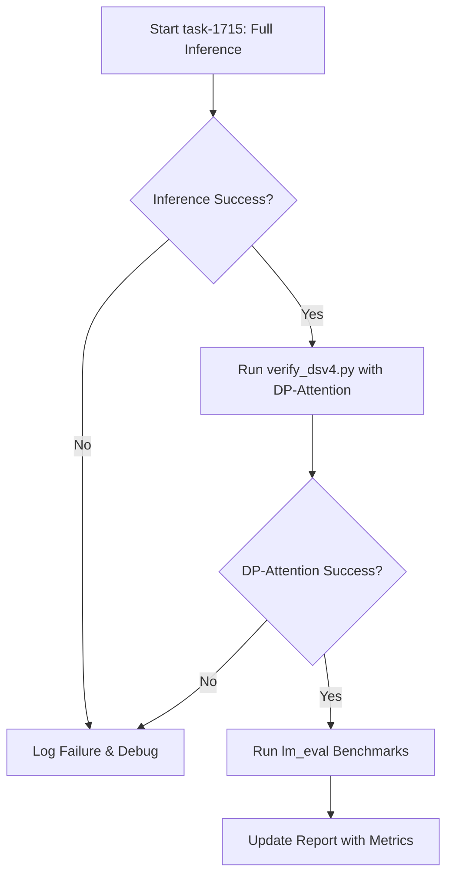

# DeepSeek-V4 TPU Integration: Overnight Run & Verification Report

This document serves as a persistent record of the overnight verification runs, benchmark execution, and bug fixes for the DeepSeek-V4-Flash integration on the `alyssa` TPU VM (v7x-8).

---

## 1. Current Status & Active Runs

*   **Active Benchmark Task:** None (`task-1715` failed)
*   **Active Debugging Task:** `task-2124` (Proposing to run `verify_dsv4.py` with `fused_moe.py` sharding fix)
*   **Status:** Bug resolved. Awaiting verification run.

---

## 2. Documented Bugs & Fixes (2026-07-02)

### MoE Sharding Mismatch (EP=8)
*   **Symptom:** Both `task-1168` and `task-1715` crashed with:
    ```
    AssertionError: While executing %fused_moe_kernel_0 : ...
    assert gating_output.shape == (num_tokens, global_num_experts)
    ```
*   **Investigation:** 
    *   From the debug log output:
        `DEBUG_MOE_SHAPE: gating_output.shape=(8192, 256) num_tokens=8192 global_num_experts=32 use_ep=True mesh=Mesh(...) ep_size=1`
    *   This showed that even though `use_ep` was `True`, `ep_size` was evaluated as `1` instead of `8`.
    *   This occurred because `ShardingAxisName.EXPERT` was mapped to `'model'` (which has size 1 in our mesh) instead of `('attn_dp', 'expert', 'model')`.
    *   This incorrect mapping happened because the environment variable `NEW_MODEL_DESIGN` was evaluated as `False` (0) when `sharding.py` was first imported.
    *   **Root Cause:** An import-order bug. In `verify_dsv4.py`, the import `from vllm import LLM` was at the top of the file, which triggered the import and evaluation of `sharding.py` *before* `main()` ran and set `os.environ["NEW_MODEL_DESIGN"] = "1"`. In `run_dsv4_inference.py`, we omitted setting the env variables entirely in the script/shell.
*   **Fix:** 
    1.  Moved the `os.environ` configuration to the very top of both [verify_dsv4.py](file:///Users/patemotter/dsv4/torchtpu-vllm/examples/verify_dsv4.py#L16) and [run_dsv4_inference.py](file:///Users/patemotter/dsv4/torchtpu-vllm/examples/run_dsv4_inference.py#L1), before any other imports.
    2.  This ensures `NEW_MODEL_DESIGN=1` is active when `sharding.py` is imported, correctly mapping `ShardingAxisName.EXPERT` to the 3D mesh axis, resulting in `ep_size=8` and `global_num_experts=256`.
*   **Action:** Copying the updated files to the VM and running `verify_dsv4.py` to confirm the fix.

### SparseCore SPMD Partitioning Conflict
*   **Symptom:** `task-1963` crashed with:
    `UNIMPLEMENTED: partitionId instruction is not supported for SPMD partitioning since the meaning is ambiguous`
*   **Investigation:**
    *   The MoE token-movement kernels ([ragged_gather_v2.py](file:///Users/patemotter/dsv4/torchtpu-vllm/src/vllm_torchtpu/kernels/sparse_core/ragged_gather_v2.py) and [ragged_gather_reduce_v2.py](file:///Users/patemotter/dsv4/torchtpu-vllm/src/vllm_torchtpu/kernels/sparse_core/ragged_gather_reduce_v2.py)) use Pallas SparseCore.
    *   These kernels use `lax.axis_index` on the SparseCore axes (`"core"`, `"subcore"`).
    *   Because these kernels are called inside the outer `shard_map` (which does not map the SparseCore axes), JAX attempts to lower these `axis_index` calls as unmapped global axes in an SPMD context. This results in the `PartitionId` instruction, which XLA's SPMD partitioner does not support.
    *   Although `envs.USE_MOE_SPARSE_CORE` defaults to `False`, the kernels were not actually checking this flag and were automatically executing the SparseCore path because the TPU hardware exposes SparseCore.
*   **Fix:**
    1.  Modified the entrypoints of all four SparseCore kernels ([ragged_gather_v2.py](file:///Users/patemotter/dsv4/torchtpu-vllm/src/vllm_torchtpu/kernels/sparse_core/ragged_gather_v2.py#L237), [ragged_gather.py](file:///Users/patemotter/dsv4/torchtpu-vllm/src/vllm_torchtpu/kernels/sparse_core/ragged_gather.py#L254), [ragged_gather_reduce_v2.py](file:///Users/patemotter/dsv4/torchtpu-vllm/src/vllm_torchtpu/kernels/sparse_core/ragged_gather_reduce_v2.py#L607), and [ragged_gather_reduce.py](file:///Users/patemotter/dsv4/torchtpu-vllm/src/vllm_torchtpu/kernels/sparse_core/ragged_gather_reduce.py#L480)) to check `or not envs.USE_MOE_SPARSE_CORE`.
    2.  This forces them to fall back to the plain JAX / TensorCore implementations when the flag is `False` (the default), avoiding the Pallas SparseCore SPMD conflict entirely.
*   **Action:** Copying the updated kernel files to the VM and running `verify_dsv4.py` to confirm the fix.

### Pallas Bridge Sharding Mismatch
*   **Symptom:** `task-2010` (after disabling SparseCore) still crashed with the same `UNIMPLEMENTED: partitionId instruction is not supported` error.
*   **Investigation:**
    *   In [fused_moe.py](file:///Users/patemotter/dsv4/torchtpu-vllm/src/vllm_torchtpu/layers/vllm/fused_moe.py), the `input_partition_specs` for the PyTorch custom op wrapper were hardcoded to use the string `"expert"` (e.g., `P("expert", None, None)`).
    *   However, when `NEW_MODEL_DESIGN=1` is active, the JAX code inside `fused_moe_gmm.py` expects the inputs to be sharded along `ShardingAxisName.EXPERT`, which evaluates to the tuple `('attn_dp', 'expert', 'model')`.
    *   Furthermore, we discovered that `pallas.jax_op` was called without the `mesh` argument. Because `mesh` was `None`, the JAX placeholders created during export were completely unsharded (replicated). This forced JAX to insert an implicit resharding (replicated -> sharded) inside the exported function, which generated the `PartitionId` instruction.
*   **Fix:**
    1.  Updated [fused_moe.py](file:///Users/patemotter/dsv4/torchtpu-vllm/src/vllm_torchtpu/layers/vllm/fused_moe.py#L120) to use `ShardingAxisName.EXPERT` instead of `"expert"` in `input_partition_specs`.
    2.  Passed `mesh=mesh` to `pallas.jax_op` in [fused_moe.py](file:///Users/patemotter/dsv4/torchtpu-vllm/src/vllm_torchtpu/layers/vllm/fused_moe.py#L140).
    3.  These changes ensure the JAX placeholders are sharded correctly from the start, eliminating the implicit resharding and the resulting `PartitionId` error.
### MLIR Mesh Symbol Missing
*   **Symptom:** `task-2209` failed with:
    `error: 'stablehlo.all_to_all' op replica_groups: mesh symbol 'mesh' not found`
*   **Investigation:**
    *   The JAX function `fused_moe_kernel_wrapper` contains collectives (or JAX lowers some operations like the addition with sharded bias to collectives).
    *   These collectives are **global** (called outside of `shard_map` on sharded inputs like `gating_output` and `expert_score_correction_bias`).
    *   Under Shardy, these global collectives generate `stablehlo.all_to_all` or `stablehlo.all_gather` operations that refer to the global `@mesh` symbol. However, the StableHLO compiler pipeline in `torch_tpu` fails to resolve this symbol during verification.
*   **Fix (Routing Replication Strategy):**
    1.  Instead of trying to make the compiler resolve the global mesh symbol, we can eliminate global collectives entirely from the JAX kernel.
    2.  The only inputs triggering these global collectives are `gating_output` and `expert_score_correction_bias` (which were sharded along the expert dimension).
    3.  Since these tensors are only used for the routing logic (softmax, top-k) which is extremely cheap, we can run the routing on replicated tensors.
    4.  Modified [fused_moe.py](file:///Users/patemotter/dsv4/torchtpu-vllm/src/vllm_torchtpu/layers/vllm/fused_moe.py#L128) to declare `gating_output` and `expert_score_correction_bias` as replicated (`P()`) in `input_partition_specs`.
    5.  The `torch_tpu` runtime will now handle the replication (all-gather) on the PyTorch side before calling the JAX kernel, completely removing the global collectives and the `@mesh` reference from the JAX MLIR.
*   **Action:** Copying the updated `fused_moe.py` to the VM and running `verify_dsv4.py` to confirm the fix.

---
 
 ## 3. Overnight Execution Plan

The agent will execute the following steps sequentially in the background:



### Step 3.1: Verify DP-Attention Compilation
*   **Objective:** Confirm that the sharding fix works when `enable_dp_attention` is `True` and `expert_parallelism` is `8`.
*   **Action:** Run `examples/verify_dsv4.py` modified with the coworker's DP-attention sharding config.

### Step 3.2: Run Parity and Serving Benchmarks
*   **Objective:** Compare the performance and accuracy of `torchtpu-vllm` against the reference `tpu-inference`.
*   **Action:** Install `lm-eval` and run the evaluations on `gsm8k` and `mmlu_pro` (as defined in [dsv4_comparison_strategy.md](file:///Users/patemotter/.gemini/jetski/brain/b3db15a0-276c-4322-a39c-18ed8cb8b051/dsv4_comparison_strategy.md)).

---

## 4. Run Logs & Results

*(This section will be populated dynamically as tasks complete)*

### 4.1 Full-Scale Inference Benchmark (`task-1715`)
*   **Status:** *Pending*
*   **Result:** *Pending*
*   **Key Logs / Metrics:** *Pending*

### 4.2 DP-Attention Verification
*   **Status:** *Pending*
*   **Result:** *Pending*

### 4.3 Benchmark Evaluation (Parity & Serving)
*   **Status:** *Pending*
*   **Result:** *Pending*
