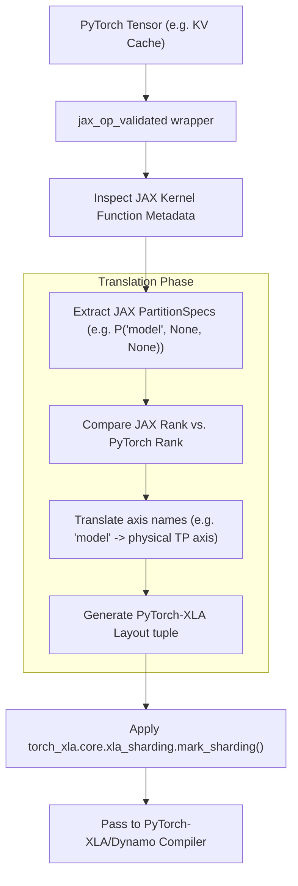

# Design Proposal: Auto-Propagate SPMD Layouts in `jax_op` (Project 2)

**Author:** Antigravity (Advanced Agentic Coding Partner)  
**Status:** `Proposed`  
**Date:** July 14, 2026  

---

## 1. Problem Statement & Context

In `torchtpu-vllm`, custom attention, indexer, and MoE GMM Pallas kernels are registered as PyTorch custom operators using the `pallas.jax_op()` wrapper. During registration, developers must manually define:
1.  `input_partition_specs`: A list of partition specs for each input tensor.
2.  `output_partition_specs`: A list of partition specs for each output tensor.

These specifications map how tensors are sharded across the physical JAX TPU device mesh. 

### Current Pain Points:
-   **Redundancy & Code Duplication:** The sharding layouts are already explicitly defined inside the JAX reference kernel (e.g. inside `_deepseek_v4_attention_jax` or `_deepseek_v4_indexer_jax`). Re-declaring them in the PyTorch wrapper leads to duplicate configuration and human errors (such as mismatched indices or wrong axis names).
-   **Static Mappings:** Changes to the JAX kernel's internal sharding parameters require immediate manual synchronization of the PyTorch wrapper configuration. If mismatched, the model crashes silently (producing `NaN` reductions) or aborts at PJRT execution boundaries.

---

## 2. Proposed Solution

We propose implementing **Project 2: Auto-Propagate SPMD Layouts in `jax_op`**. 
Rather than requiring manual configuration lists, the custom operator wrapper will programmatically introspect the underlying JAX function signature at build/registration time. It will extract JAX's native `PartitionSpec` metadata, translate those layouts to PyTorch-XLA SPMD format, and automatically execute `torch_xla.core.xla_sharding.mark_sharding` on the corresponding PyTorch tensors.

### 2.1 Architectural Flow


---

## 3. Detailed Design

### 3.1 Metadata Extraction and Layout Translation
JAX defines sharding specs via `jax.sharding.PartitionSpec`. PyTorch-XLA specifies sharding layouts using tuples of axis names or indices.

The translator will perform the following steps:
1.  **Extract spec:** Retrieve the JAX `PartitionSpec` attribute bound to the parameters of the JAX function wrapped by `pallas.jax_op`.
2.  **Translate named axes:** Map JAX mesh names to the corresponding PyTorch cluster mesh axis names:
    -   `ShardingAxisName.ATTN_DATA` $\rightarrow$ `self.mesh.axis_names[0]` (usually `attn_dp`)
    -   `ShardingAxisName.ATTN_HEAD` $\rightarrow$ Dynamic axis resolution (`expert`, `model`, or `attn_dp`)
3.  **Adjust Rank Mismatches:** If JAX compiles the kernel expecting a 4D tensor (e.g. KV cache without head-sharing) but PyTorch represents the cache as 5D (with head-sharing), the translator will pad the layout tuple at the correct index with `None` (replicated) to prevent rank crashes.

### 3.2 Code API Design Mockup
```python
# Before (Manual Specs):
attn_op = pallas.jax_op(
    "pallas::attn",
    _deepseek_v4_attention_jax,
    input_partition_specs=[P("batch", None), P(None, None), ...],
    output_partition_specs=[P("batch", None)]
)

# After (Auto-Propagated):
attn_op = jax_op_validated(
    "pallas::attn",
    _deepseek_v4_attention_jax,
    auto_sharding=True  # Infers all input/output partition specs dynamically from JAX metadata!
)
```

---

## 4. Work Breakdown & Task List

*   **Task 2.1: Introspection Hook Implementation**
    - Locate JAX kernel parameter sharding specifications (inspect `_deepseek_v4_attention_jax` and `jax.eval_shape` outputs).
    - Parse internal Pallas wrapper signatures to extract mapping tables dynamically.
*   **Task 2.2: PartitionSpec Translator Development**
    - Create `vllm_torchtpu/compilation/sharding_translator.py`.
    - Implement translations: JAX `PartitionSpec` $\rightarrow$ PyTorch-XLA layout tuples.
    - Write logic to resolve dynamic sharding axes (e.g., meta-class mappings for `ShardingAxisName.ATTN_HEAD`).
*   **Task 2.3: Interceptor Integration**
    - Update our registration wrapper to intercept forward and fake tensor registry passes.
    - Programmatically run `torch_xla.core.xla_sharding.mark_sharding` on all parameters prior to graph lowering.
*   **Task 2.4: Layout Parity Verification**
    - Create a test suite `tests/compilation/test_auto_sharding.py` to compare auto-translated layouts against manually declared ones for all MLA and MoE layers.

---

## 5. Expected System Value & Trade-offs

*   **System Value:**
    - **Eliminates Sharding Bugs:** Solves the entire class of silent partition errors that lead to NaN output reductions or PJRT buffer crashes.
    - **Dryer Codebase:** Removes 150+ lines of duplicate layout specifications from `deepseek_v4.py`.
*   **Trade-offs / Complexity:**
    - **Introspection Overhead:** Inspecting JAX functions takes ~10-20ms per operator at startup, which is negligible compared to the ~2 minute total XLA compilation time.
    - **Dependency on JAX API:** Relies on JAX sharding API stability. If JAX internals change, the translator might need updates (mitigated by using stable standard `PartitionSpec` types).
