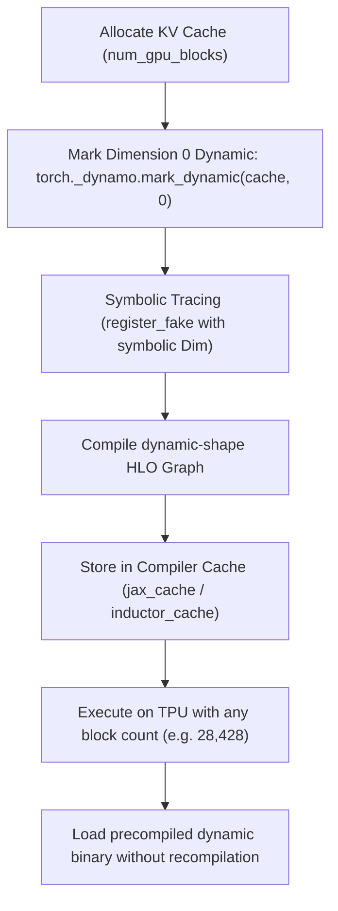

# Design Proposal: Dynamic KV Cache Block Allocation Dimension (Project 4)

**Author:** Antigravity (Advanced Agentic Coding Partner)  
**Status:** `Proposed`  
**Date:** July 14, 2026  

---

## 1. Problem Statement & Context

In `torchtpu-vllm`, physical memory for Key and Value tokens is managed via **Paged KV Cache**. Memory is divided into pages of blocks. The number of blocks allocated (`num_gpu_blocks`) is determined dynamically at startup during `profile_run` based on the environment variable `GPU_MEM_UTIL` (which determines the HBM fraction allocated to the cache, e.g. 70% or 90% of available memory).

### Current Pain Points:
-   **Compile-Time OOMs (`CompileTimeHbmOom`):** Because the block allocation count (`num_gpu_blocks`) is part of the KV cache tensor's shape (dimension 0, e.g. `[28428, 512]`), changing `GPU_MEM_UTIL` alters the compile shape of the model. 
-   **Unnecessary Recompilations:** If a user adjusts `GPU_MEM_UTIL` in production (e.g. from `0.70` to `0.80`), the compiled model graph changes. PyTorch-XLA does not reuse the pre-compiled binary on disk and triggers a slow 2-minute recompilation.
-   **Manual Tuning Loop:** Developers must iteratively guess and test the exact `GPU_MEM_UTIL` and `XLA_CLIENT_MEM_FRACTION` values to satisfy the parameter weight size without exhausting the compilation HBM budget.

---

## 2. Proposed Solution

We propose implementing **Project 4: Dynamic KV Cache Block Allocation Dimension**.
This project enables dynamic shape tracking for the physical block count dimension (index 0) of all layer KV Cache tensors. By marking this dimension dynamic in PyTorch Dynamo, the compiler generates a single symbolic-shape StableHLO execution graph that is compiled once. 

Once compiled, the model can run with **any** physical block count configuration (and any `GPU_MEM_UTIL` value) without triggering recompilation or compile-time OOMs.

### 2.1 Architectural Flow


---

## 3. Detailed Design

### 3.1 Dynamic Dimension Registration
Inside `initialize_kv_cache` in `vllm_torchtpu/runner/tpu_runner.py`, we apply the `mark_dynamic` annotation immediately after tensor allocation:

```python
# Apply to both Key and Value caches across all layers
for layer_idx in range(num_layers):
    # cache shape: [num_blocks, num_kv_heads, head_dim, block_size, ...]
    torch._dynamo.mark_dynamic(self.gpu_cache[layer_idx][0], 0)  # Key cache dimension 0 dynamic
    torch._dynamo.mark_dynamic(self.gpu_cache[layer_idx][1], 0)  # Value cache dimension 0 dynamic
```

### 3.2 Symbolic Fake Tensor Registry
The custom Pallas operators (`attn_op`, `group_proj_op`, and GMM kernels) accept block tables or page references. Their corresponding fake tensor implementations inside `deepseek_v4.py` must be updated to trace inputs using symbolic dimensions instead of concrete integers.

```python
# Before (Static trace):
def _fake_attn(q, k_cache, ...):
    assert k_cache.shape[0] == 28428  # hardcoded shape constraint
    return torch.empty(...)

# After (Symbolic trace):
def _fake_attn(q, k_cache, ...):
    # Accept any symbolic integer size for the block dimension
    num_blocks = k_cache.shape[0]
    return torch.empty(...)
```

---

## 4. Work Breakdown & Task List

*   **Task 4.1: Register Dynamic Cache Dimension**
    - Locate the cache allocation loop in `initialize_kv_cache` inside `vllm_torchtpu/runner/tpu_runner.py`.
    - Apply `torch._dynamo.mark_dynamic` to index 0 of key/value cache tensors.
*   **Task 4.2: Symbolic Custom Op Schema Registry**
    - Audit all fake tensor signatures (`_fake_indexer`, `_fake_attn`, `_fake_compressor`) in `vllm_torchtpu/layers/vllm/custom_ops/deepseek_v4.py`.
    - Replace concrete integer dimension checks with symbolic shape evaluations.
*   **Task 4.3: Validate Compile Reusability**
    - Run `verify_dsv4.py` with `GPU_MEM_UTIL=0.20`.
    - Change `GPU_MEM_UTIL` to `0.40` and execute again.
    - Confirm that the second run completes startup instantly without compiling a new HLO graph.

---

## 5. Expected System Value & Trade-offs

*   **System Value:**
    - **No Recompilations on Config Changes:** Users can dynamically scale the block cache allocation size based on hardware availability without recompiling the model.
    - **Solves Compile-Time OOMs:** Bypasses `CompileTimeHbmOom` errors, allowing serving deployment at maximum (90%+) HBM capacities.
*   **Trade-offs / Complexity:**
    - **Symbolic Indexing Lookup:** Generating dynamic shape index offsets introduces minor compiler index-lowering complexity.
    - **Zero Throughput Impact:** Since the block dimension is strictly used for page index tables/gather operations and does not enter any dense GEMM multiplications, TPU token throughput remains 100% unaffected.
