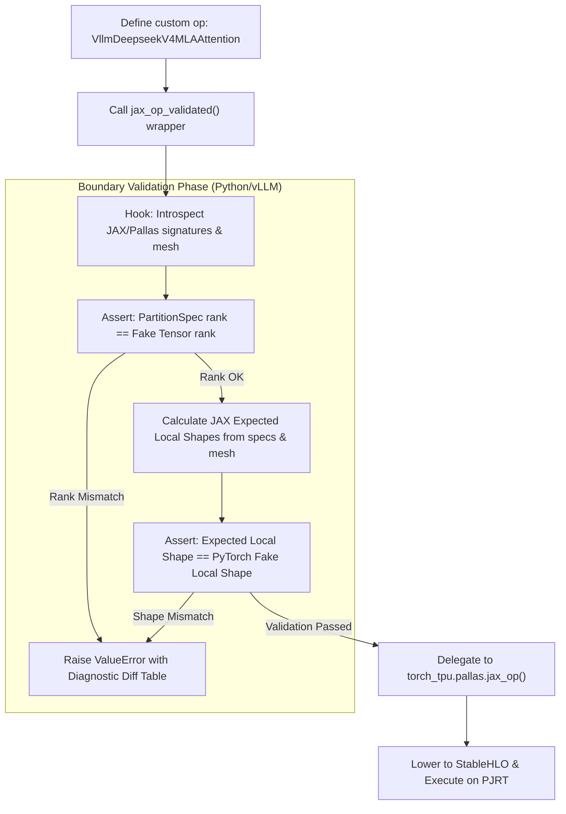

# Design Proposal: Compile-Time Custom Op Signature & Sharding Validation (Project 5)

**Author:** Antigravity (Advanced Agentic Coding Partner)  
**Status:** `Proposed`  
**Date:** July 14, 2026  

---

## 1. Problem Statement & Context

When developing custom operators in `torchtpu-vllm` that bridge the PyTorch (Dynamo tracing) and JAX/Pallas (StableHLO compilation) boundaries via `pallas.jax_op()`, developers frequently encounter rank, shape, or sharding layout conflicts.

Currently, there is no validation between:
1.  The PyTorch symbolic fake tensor shapes registered via `register_fake`.
2.  The PyTorch/XLA input/output sharding specifications (`input_partition_specs`, `output_partition_specs`).
3.  The JAX compiler's expected sharding configurations and global mesh coordinates.

Because validation is deferred to the physical device runtime, rank or shape mismatches fail late at execution time inside the PJRT materializer, emitting highly cryptic C++ backend driver logs:
```
ExecutionTask failed: INVALID_ARGUMENT: buffer 0: incompatible buffer shapes at dimension 0; for op shape [1024, 512] and buffer shape s32[128,512]
```
These errors do not map to Python stack traces, mask the actual parameter name that failed, and require tedious manual reverse-engineering of compiled shapes to isolate the root cause.

---

## 2. Proposed Solution

We propose implementing **Project 5: Compile-Time Custom Op Signature & Sharding Validation**. 
Instead of modifying the pre-compiled `torch_tpu` library, we will implement a repository-local helper wrapper `jax_op_validated(...)` inside `vllm_torchtpu`. This wrapper will intercept custom operator instantiation, perform static shape and sharding rank assertions at initialization/trace time, and raise descriptive Python exceptions before XLA graph lowering begins.

### 2.1 Architectural Flow


---

## 3. Detailed Design

### 3.1 Local Shape Calculation Formula
For a tensor with global symbolic/fake shape $G = [d_0, d_1, d_2, \dots, d_{n-1}]$, PartitionSpec $S = P(a_0, a_1, a_2, \dots, a_{n-1})$, and JAX mesh shape bindings $M$ (mapping axis names to sizes, e.g. `{'attn_dp': 8, 'model': 1}`):

The expected local shard shape $L = [l_0, l_1, l_2, \dots, l_{n-1}]$ is resolved dimension-by-dimension:
$$l_i = \begin{cases} 
d_i / M[a_i] & \text{if } a_i \text{ is in } M \\
d_i & \text{if } a_i \text{ is } None \text{ (replicated)} 
\end{cases}$$

If the PyTorch worker process passes a tensor whose local shape does not equal $L$, a sharding/signature conflict exists.

### 3.2 Mock Diagnostic Error Output
If a mismatch is detected, the wrapper will raise a `ValueError` formatting a diagnostic table:

```
ValueError: Custom Op Sharding Validation Mismatch in 'pallas::deepseek_v4_attention_layers_0'
----------------------------------------------------------------------------------------------------------------------------------------------------------------------------------------------------------------------------------------------------------------------------------------------------------------------------------------------------------------------------------------------------------------------------------------------------------------------------------------------------------------------------------------------------
Parameter Name/Index   | PartitionSpec                  | Global Shape    | Expected Local Shape (JAX) | Received Local Shape (PyTorch) | Status
----------------------------------------------------------------------------------------------------------------------------------------------------------------------------------------------------------------------------------------------------------------------------------------------------------------------------------------------------------------------------------------------------------------------------------------------------------------------------------------------------------------------------------------------------
0. q                   | P('attn_dp', 'model', None)    | [1024, 8, 512]  | [128, 8, 512]              | [128, 8, 512]                  | [MATCH]
3. swa_kv_lens         | P('batch_axis')                | [1024]          | [128]                      | [128]                          | [MATCH]
9. extra               | P('batch_axis')                | [1024, 512]     | [128, 512]                 | [128, 512]                     | [MISMATCH: Spec rank is 1, but PyTorch tensor rank is 2!]
10. main_page_indices  | P(None, None)                  | [1024, 512]     | [1024, 512]                | [128, 512]                     | [MISMATCH: JAX expected replicated [1024, 512], but PyTorch passed sharded [128, 512]!]
----------------------------------------------------------------------------------------------------------------------------------------------------------------------------------------------------------------------------------------------------------------------------------------------------------------------------------------------------------------------------------------------------------------------------------------------------------------------------------------------------------------------------------------------------
```

---

## 4. Work Breakdown & Task List

*   **Task 5.1: Implement Local Validation Wrapper Hook**
    - Create `src/vllm_torchtpu/compilation/op_validation.py`.
    - Define `jax_op_validated` that matches the exact function signature of `torch_tpu.pallas.jax_op`.
    - Retrieve JAX mesh properties (`mesh.shape`, `mesh.axis_names`) dynamically at wrapper call time.
*   **Task 5.2: Develop PartitionSpec Parser & Local Shape Calculator**
    - Write layout parser mapping PyTorch `PartitionSpec` tuple structures to mesh partition divisions.
    - Handle rank validation, padding, and squeezing conversions (e.g. ignoring `None` placeholders).
*   **Task 5.3: Diagnostic Reporter & Diff Formatting**
    - Implement a structured log/table generator formatting layout diffs upon validation failures.
    - Hook the checker into `jax_op_validated` so that it intercepts registration fake functions as well.
*   **Task 5.4: Parity Test Suite**
    - Create `tests/compilation/test_custom_op_validation.py`.
    - Test standard 1D/2D/3D mesh variations and verify that rank mismatch errors are caught at startup.

---

## 5. System Value & Trade-offs

*   **System Value:**
    - **Reduced Debugging Cycle Time:** Mismatches are caught instantly in python (taking <1s) during tracing, rather than after 2 minutes of model checkpoint loading and compilation.
    - **Actionable Stack Traces:** Developers are pointed to the exact mismatched parameter and visual dimension diffs, instead of hunting through raw PJRT memory hex addresses.
*   **Trade-offs / Complexity:**
    - **Zero Execution Path Latency:** The validation checker runs strictly during model initialization/compilation. Once the graph compiles, it runs with 0% runtime overhead.
    - **No Code Risk:** It is a pure validation wrapper, leaving low-level JAX compilation and StableHLO code generation untouched.
