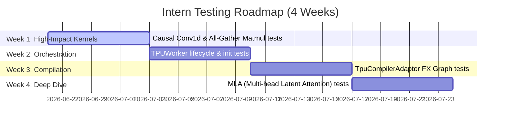

# Testing Audit and 4-Week Intern Roadmap for `torchtpu-vllm`

This document provides a factual assessment of the current testing state of the `torchtpu-vllm` repository, identifies high-risk coverage gaps, and outlines a structured 4-week roadmap for an intern to improve testing.

---

## 1. Executive Summary

- **Current State:** The codebase uses `pytest` as its primary test runner, with JAX-based kernel tests using `absl.testing`. The testing strategy is divided between **mock-based unit tests** (which run on CPU and verify distributed state machine logic) and **hardware-dependent integration/kernel tests** (which require physical TPU v7+ devices).
- **Major Strengths:** The distributed coordination modules (`TPUConnector`, `RaidenTransferEngine`) have high-quality, mock-based unit tests that run completely on CPU.
- **Major Gaps:** 
  1. Several high-impact, complex custom kernels are completely untested (0% coverage).
  2. The core orchestration class (`TPUWorker`) lacks dedicated unit tests.
  3. The compilation pipeline's FX graph lowering and cache invalidation logic are not directly tested.
  4. Tests are tightly coupled to TPU hardware, preventing local developer verification on CPU-only machines.

---

## 2. Codebase Audit: Source vs. Test Coverage

The table below maps the packages in `src/vllm_torchtpu/` to their corresponding test coverage in `tests/`.

| Component / Package | Source Path | Test Path | Coverage Status | Primary Testing Strategy |
| :--- | :--- | :--- | :--- | :--- |
| **Custom Kernels** | `kernels/` | `tests/kernels/` | **Partial** | TPU Hardware Dependent |
| ↳ *MLA (Multi-head Latent Attention)* | `kernels/mla/` | None | **0% (Untested)** | N/A |
| ↳ *Causal Conv1d* | `kernels/causal_conv1d/` | None | **0% (Untested)** | N/A |
| ↳ *Collectives (All-Gather Matmul)* | `kernels/collectives/` | None | **0% (Untested)** | N/A |
| ↳ *Flash Attention* | `kernels/flash_attention/` | None | **0% (Untested)** | N/A |
| ↳ *Grouped Gemm (Megablox)* | `kernels/megablox/` | `tests/kernels/test_gmm_v2.py` | Covered | Requires TPU |
| ↳ *Quantized Matmul* | `kernels/quantized_matmul/` | `tests/kernels/test_quantized_matmul_kernel.py` | Covered | Requires TPU v7+ |
| ↳ *Ragged Paged Attention* | `kernels/ragged_paged_attention/` | `tests/kernels/test_rpa_skip_kv_update.py` | Covered | Requires TPU |
| ↳ *Sparse Core* | `kernels/sparse_core/` | `tests/kernels/test_ragged_gather_reduce.py` | Covered | Requires TPU |
| **Process Orchestration** | `worker/` | None | **0% (Untested)** | N/A (Tested transitively via E2E) |
| ↳ *TPU Worker* | `worker/tpu_worker.py` | None | **0% (Untested)** | N/A |
| **Compilation Pipeline** | `compilation/` | `tests/compilation/` | **Partial** | Mock-based |
| ↳ *TpuCompilerAdaptor* | `compilation/tpu_compiler.py` | `tests/compilation/test_tpu_compiler.py` | Covered (Env/Dir only) | Mock-based. **Core `compile` method is untested.** |
| **Distributed / KV Transfer** | `distributed/` | `tests/distributed/` | **High** | Mock-based (No TPU required) |
| ↳ *Raiden Transfer Engine* | `distributed/kv_transfer/raiden_transfer_engine.py` | `tests/distributed/test_raiden_transfer_engine.py` | Covered | Mock-based |
| ↳ *TPU Connector* | `distributed/kv_transfer/tpu_connector.py` | `tests/distributed/test_tpu_connector.py` | Covered | Mock-based |
| **Model Runner** | `runner/` | `tests/runner/test_tpu_runner.py` | **High** | Mock-based (No TPU required) |
| ↳ *TPU Model Runner* | `runner/tpu_runner.py` | `tests/runner/test_tpu_runner.py` | Covered | Mock-based |
| **Platform Plugin** | `platforms/` | `tests/platforms/` | **High** | Mock-based |
| ↳ *TPU Platform* | `platforms/tpu_platform.py` | `tests/platforms/test_tpu_platform.py` | Covered | Mock-based |

---

## 3. Critical Testing Gaps Analysed

### Gap A: Complex, Untested Custom Kernels (MLA, Causal Conv1d, Collectives)
- **MLA (`kernels/mla/v1/kernel.py`):** A 50KB Pallas/JAX kernel implementing Multi-head Latent Attention. This is highly complex, handling key/value compression and decoupling, which is critical for DeepSeek model families. It has zero test coverage, representing a high regression risk.
- **Causal Conv1d (`kernels/causal_conv1d/causal_conv1d.py`):** 19KB of Pallas code for hybrid architectures (Mamba/Jamba). Completely untested.
- **All-Gather Matmul (`kernels/collectives/all_gather_matmul.py`):** 27KB of code that overlaps TP communication with matrix multiplication. Untested.

### Gap B: Untested `TPUWorker` Orchestration
- `TPUWorker` handles the lifecycle of worker processes (initializing distributed backends, applying runtime monkeypatches, registering memory profilers, and running execution loops).
- **Risk:** Changes to import ordering or initialization sequences can break the distributed runner without throwing local compilation errors.
- **Requirement:** A dedicated unit test suite that mocks out `torch_tpu` and JAX distributed backends to verify that initialization steps are executed in the correct order.

### Gap C: TpuCompilerAdaptor Core Compilation Logic
- `tests/compilation/test_tpu_compiler.py` only tests environment variable parsing and directory paths.
- **Risk:** The actual `compile` method (which invokes the `TpuBackend`, handles FX-to-MLIR lowering, wraps single-tensor graph outputs in tuples, and manages serialization to disk) is completely untested in isolation.
- **Requirement:** Unit tests that pass simple, dummy FX graphs (e.g., a graph performing element-wise addition) to the compiler to verify:
  1. Correct compilation and serialization to the disk cache.
  2. Cache-key invalidation when source files listed in `_RUNTIME_CACHE_KEY_PATHS` change.
  3. Tuple output wrapping when the graph returns a single tensor.

### Gap D: Strong Hardware Coupling
- Most kernel and layer tests immediately raise a failure or skip if a physical TPU is not found.
- **Impact:** Developers cannot run these tests locally on CPU machines to check for syntax, type, or shape-checking errors.
- **Requirement:** A structural pattern that allows JAX kernels to run their shape-validation, tracing, and wrapper logic on CPU (using JAX's CPU backend) where feasible, failing or skipping only when TPU-specific Pallas instructions are hit.

---

## 4. 4-Week Intern Roadmap

This roadmap is designed to guide an intern through progressively more complex components, starting with highly structured kernel unit tests and ending with the highly complex MLA kernel.

### Week 1: High-Impact, Untested Kernels (`causal_conv1d` & `all_gather_matmul`)
- **Objective:** Establish baseline unit tests for two critical, untested kernels.
- **Tasks:**
  1. Create `tests/kernels/test_causal_conv1d.py`. Write a pure PyTorch/NumPy reference implementation. Write parameterized tests comparing the Pallas kernel output against the reference across multiple batch sizes, channel widths, and sequence lengths.
  2. Create `tests/kernels/test_all_gather_matmul.py`. Write a reference implementation of a batched matrix multiplication combined with an all-gather operation. Use JAX's CPU backend to test the mathematical correctness.
- **Success Criteria:** 
  - Tests pass on a CPU (where mockable) or TPU runner.
  - Test coverage for `kernels/causal_conv1d/` and `kernels/collectives/` increases from 0% to >80%.

### Week 2: TPUWorker Orchestration & Environment Setup
- **Objective:** Write mock-based unit tests for the worker process lifecycle.
- **Tasks:**
  1. Create `tests/worker/test_tpu_worker.py`.
  2. Use `unittest.mock` to patch out heavy dependencies: `torch_tpu`, `jax.distributed`, `profiler_api`, and `TPUModelRunner`.
  3. Write tests to verify:
     - `apply_tpu_patches` is called during initialization.
     - `self.device` attribute is correctly deleted to prevent vLLM executor crashes.
     - The profiler is only initialized on rank 0 for single-host configurations.
     - Pipelines are set up correctly with pipeline parallel size > 1.
- **Success Criteria:** 
  - All tests execute and pass on a CPU (no TPU hardware required).
  - Verifies that initialization steps occur in the correct order.

### Week 3: TpuCompilerAdaptor Core Compilation Logic
- **Objective:** Unit test the FX graph compilation, caching, and lowering pipeline.
- **Tasks:**
  1. Add tests to `tests/compilation/test_tpu_compiler.py` that construct simple `torch.fx.GraphModule` instances.
  2. Verify that `_ensure_tuple_output` wraps single-tensor outputs but leaves multi-tensor outputs unchanged.
  3. Mock the underlying `TpuBackend` compilation call to test the `TpuCompilerAdaptor.compile` caching logic:
     - Assert that the first compilation writes a serialized pickle file to the cache directory.
     - Assert that the second compilation with the same graph hashes loads from the cache instead of recompiling.
     - Assert that modifying a file in `_RUNTIME_CACHE_KEY_PATHS` changes the hash and invalidates the cache.
- **Success Criteria:**
  - Complete coverage of `TpuCompilerAdaptor.compile` and caching logic.
  - Tests run on CPU (no TPU compilation backend needed if backend is mocked).

### Week 4: The Deep Dive - MLA (Multi-head Latent Attention) Kernel Tests
- **Objective:** Build a robust, parameterized unit test suite for the highly complex MLA kernel.
- **Tasks:**
  1. Create `tests/kernels/test_mla.py`.
  2. Write a pure PyTorch reference implementation of Multi-head Latent Attention (including KV compression, decompression, and scaling).
  3. Write parameterized tests for `vllm_torchtpu/kernels/mla/v1/kernel.py` comparing the Pallas kernel output against the PyTorch reference across:
     - Different sequence lengths (prefill vs. decode).
     - Different compression dimensions ($d_c$) and decoupled query dimensions ($d_k'$).
     - Single-query vs. multi-query scenarios.
- **Success Criteria:**
  - MLA kernel outputs match the PyTorch reference within acceptable numerical tolerance (`atol=1e-2`, `rtol=1e-2`).
  - MLA kernel coverage increases from 0% to >80%.
