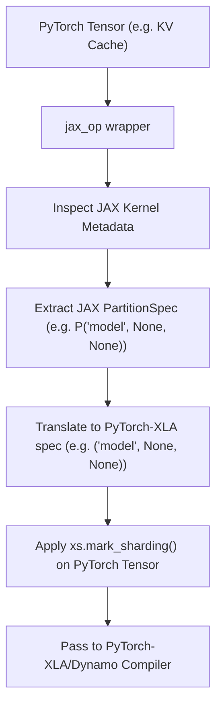
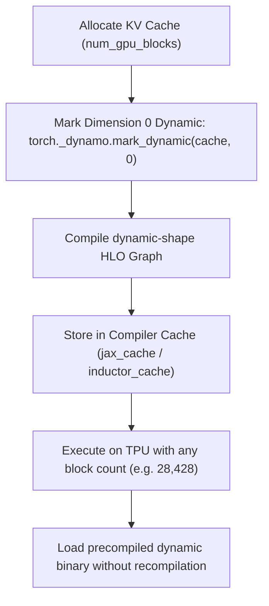
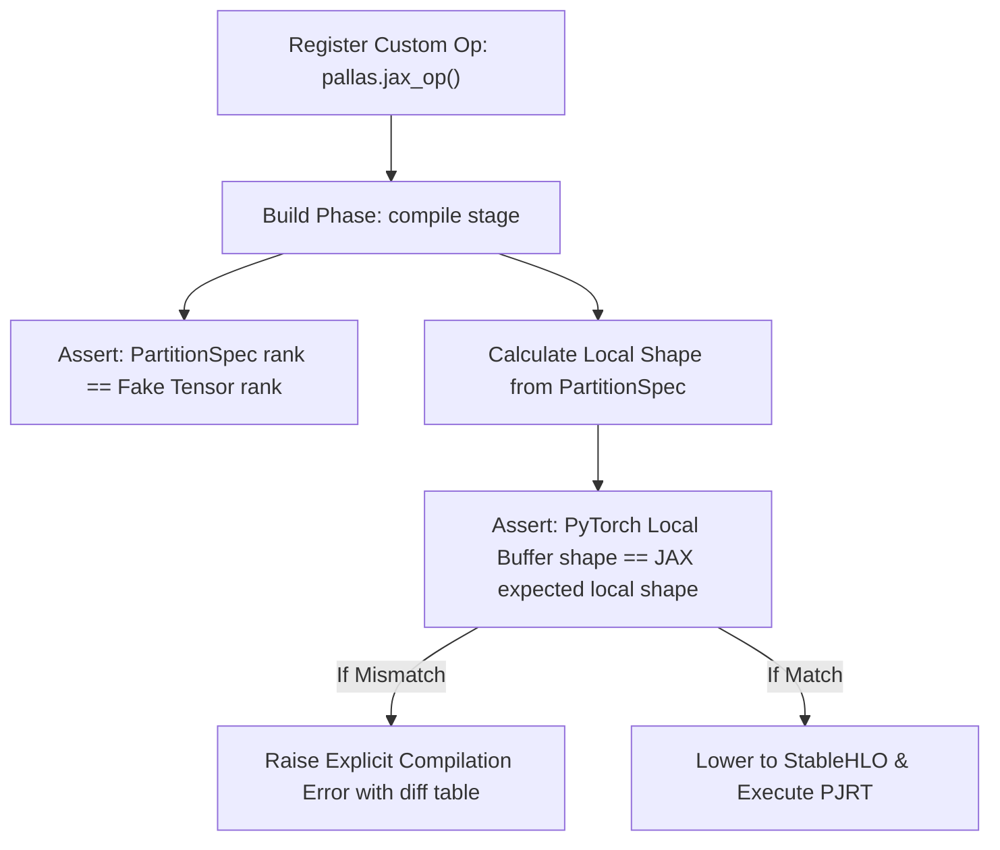

# TorchTPU Improvement Projects

This document provides structured project outlines, designs, and task breakdowns for the proposed roadmap items aimed at reducing developer friction and improving memory safety when developing for DeepSeek-V4 in `torchtpu-vllm`.

---

## Project 2: Auto-Propagate SPMD Layouts in `jax_op`

### 1. Objective
Eliminate manual sharding configuration errors (such as commenting out KV Cache sharding) by enabling the `torch_tpu` custom operator wrapper (`jax_op`) to automatically inspect, translate, and apply sharding specifications from JAX/Pallas metadata to PyTorch tensors.

### 2. Architectural Design


*   **Metadata Extraction**: When a JAX-patched custom kernel (e.g., `_deepseek_v4_compressor_jax`) is wrapped by `pallas.jax_op()`, the wrapper will introspect the JAX function parameters to extract their defined `PartitionSpec` metadata and mesh axis bindings.
*   **Layout Translation**: Map JAX `PartitionSpec` definitions (which support dimensions, replica groups, and named axes) directly to PyTorch-XLA's SPMD tuple configuration format:
    *   `PartitionSpec('model', None, None)` $\rightarrow$ `('model', None, None)`
    *   Support dynamic shape rank conversions (e.g., translating 4D JAX layouts to 5D PyTorch MLA layouts automatically).
*   **Automatic Interception**: Execute `torch_xla.core.xla_sharding.mark_sharding` programmatically inside the custom operator execution pathway for both inputs (prior to tracing) and outputs (post tracing).

### 3. Work Breakdown & Task List

*   **Task 2.1: Introspection Hook Implementation**
    *   Locate the inner implementation of `torch_tpu._internal.pallas.jax_op`.
    *   Add metadata retrieval utilities to parse Pallas kernel signatures and extract JAX mesh shapes and `PartitionSpec` attributes.
*   **Task 2.2: PartitionSpec Translator Development**
    *   Write a robust translation module `vllm_torchtpu.compilation.sharding_translator` that handles edge cases:
        *   Dimension rank mismatch resolution (e.g., slicing/padding tuple lengths).
        *   Named axis alias mapping (mapping JAX names like `expert` or `attn_dp` to the PyTorch `self.mesh` labels).
*   **Task 2.3: Interceptor Pipeline Integration**
    *   Hook the translator into `jax_op.forward` and `jax_op.register_fake` boundaries.
    *   Apply `mark_sharding` to all PyTorch inputs and verify that layout propagation is respected during StableHLO graph tracing.
*   **Task 2.4: Verification & Test Suite**
    *   Create a parameterized test suite `tests/compilation/test_auto_sharding.py` simulating 4D, 5D, and 6D tensors across 1D/2D/3D meshes to verify layout parity.

---

## Project 3: Optimize V1 Warmup Tracing

### 1. Objective
Minimize the memory overhead and execution latency during the vLLM engine initialization (warmup/pre-compilation) phase, preventing the compiler from allocating duplicate KV Cache graphs in HBM simultaneously.

### 2. Architectural Design
Instead of compiling independent graphs for multiple paddings sequence lengths (e.g., `[16, 32, 64, 128]`), we implement two key memory mitigation strategies:

#### Strategy A: Single-Buffer Slicing
```
Warmup Loop:
  Shape = 16  ──> Slices Single KV Cache Buffer [0:16]  ──> Compiles Graph
  Shape = 32  ──> Slices Single KV Cache Buffer [0:32]  ──> Compiles Graph
  Shape = 64  ──> Slices Single KV Cache Buffer [0:64]  ──> Compiles Graph
  Shape = 128 ──> Slices Single KV Cache Buffer [0:128] ──> Compiles Graph
```
Rather than creating separate dummy KV cache tensors for each compiled shape, we allocate a single global memory buffer. During warmup, the model forward pass is fed sliced views of this single buffer, allowing the compiler to reuse memory locations.

#### Strategy B: Dynamic Shapes Compilation
Compile the model with **dynamic shapes enabled** for the sequence length dimension (`torch.compile(..., dynamic=True)`). Instead of compiling 4 distinct static graphs, XLA compiles a single symbolic graph, reducing HBM allocation overhead by 4x and compilation time by 75%.

### 3. Work Breakdown & Task List

*   **Task 3.1: Refactor Warmup Allocation Flow**
    *   Modify `capture_model` inside `vllm_torchtpu/runner/tpu_runner.py`.
    *   Prevent initialization of multiple dummy KV caches. Pre-allocate a single global cache block and pass sliced views (`cache[:, :size]`) to the compilation runner.
*   **Task 3.2: Enable Dynamic Sequence Length Compilation**
    *   Configure the `TpuCompilerAdaptor` to support dynamic compilation.
    *   Register the sequence length dimension (`num_tokens`) as a dynamic dimension via `torch._dynamo.mark_dynamic()`.
    *   Verify that only a single dynamic HLO graph is compiled for the entire sequence range.
*   **Task 3.3: Compiler Cache Cleanup Hooks**
    *   Add explicit step execution markers (`xm.mark_step()`) and garbage collection calls (`gc.collect()`) inside the warmup loop to purge temporary compilation tracer nodes immediately.
*   **Task 3.4: Compilation Profile Parity Validation**
    *   Measure and verify HBM allocations during engine warmup using the GKE telemetry tool to ensure HBM stays flat during startup.

---

## Project 4: Dynamic KV Cache Block Allocation Dimension

### 1. Objective
Enable dynamic shape tracking for the KV cache's physical block allocation dimension (the first axis of the cache tensors) in PyTorch-XLA/Dynamo to allow compiling a single dynamic-shape execution graph. This prevents compile-time OOMs (`CompileTimeHbmOom`) and eliminates the need for manual `GPU_MEM_UTIL` tuning during compilation.

### 2. Architectural Design


*   **Dynamic Dimension Registration**: Register the physical block count dimension (index 0) of all layer KV Cache tensors as dynamic in the PyTorch Dynamo compiler:
    ```python
    torch._dynamo.mark_dynamic(cache_tensor, 0)
    ```
*   **Symbolic Shape Tracing**: Configure custom JAX operators (`attn_op` / `group_proj_op`) and their `register_fake` signature mapping bounds to trace inputs using symbolic dimensions (e.g. `torch.export.Dim("num_blocks")`) rather than concrete integer sizes.
*   **Compilation Parity**: Confirm that Phase 1 compilation (`profile_run`) generates a dynamic-shape JIT binary on disk, and Phase 2 (`capture_model`) successfully reuses this binary.

### 3. Work Breakdown & Task List

*   **Task 4.1: Register Dynamic Cache Dimension**
    *   Locate the KV cache tensor allocation logic in `initialize_kv_cache` inside `vllm_torchtpu/runner/tpu_runner.py`.
    *   Apply `torch._dynamo.mark_dynamic` to index 0 of the allocated tensors prior to graph execution.
*   **Task 4.2: Symbolic Custom Op Schema Registry**
    *   Update `FakeTensor` registry signatures in `vllm_torchtpu/layers/vllm/custom_ops/deepseek_v4.py` to support variable/symbolic shapes for cache dimensions.
*   **Task 4.3: Validate Compile Reusability**
    *   Verify that varying the `GPU_MEM_UTIL` value (e.g. `0.20` vs `0.40`) does not trigger recompilation or changes to the HLO executable hash key.

### 4. Trade-offs & Performance
*   **Downside**: Minor compiler overhead when generating dynamic index lookups.
*   **Performance Impact**: Near 0% throughput difference, since the block dimension is strictly used for page index tables/gather operations and does not enter any dense GEMM multiplications.

---

## Project 5: Compile-Time Custom Op Signature & Sharding Validation

### 1. Objective
Enable early detection of sharding layouts and shape mismatch errors at the PyTorch <-> JAX compilation boundary, preventing cryptic PJRT hardware execution crashes (`ExecutionTask failed: buffer 0: incompatible buffer shapes...`) by raising clean compile-time exceptions.

### 2. Architectural Design


*   **Static Rank Validation**: Inside our own repository-local custom op registration helper (which wraps `pallas.jax_op`), verify that the rank (number of dimensions) of each provided `PartitionSpec` in `input_partition_specs` and `output_partition_specs` matches the rank of the corresponding tensor signature returned by `register_fake`.
*   **Static Local Shape Verification**:
    - For each tensor input/output, parse the sharding specification.
    - Retrieve the target JAX mesh layout shape.
    - Compute the expected local shard shape: e.g. for global shape `[1024, 512]` and spec `P("batch", None)` on a mesh where `batch` size is 8, the local shape must be `[128, 512]`.
    - Assert that this calculated shape matches the PyTorch symbolic fake tensor local shape.
*   **Structured Diagnostics Log**: If any assertion fails, intercept the exception and format a readable diagnostic table listing all inputs/outputs, their global shapes, sharding layouts, expected local shapes, and received PyTorch local shapes.

### 3. Work Breakdown & Task List
*   **Task 5.1: Implement Local Custom Op Validation Wrapper**
    - Implement a helper function `vllm_torchtpu.compilation.jax_op_validated` inside our codebase that wraps the third-party `torch_tpu.pallas.jax_op` builder.
    - Retrieve active JAX Mesh details (`mesh.shape`, `mesh.axis_names`) at build time.
*   **Task 5.2: Develop Local Shape Calculator**
    - Write a utility `vllm_torchtpu.compilation.verify_layouts` that parses a PyTorch `PartitionSpec` tuple and computes expected local dimension sizes based on mesh axis division.
*   **Task 5.3: Diagnostic Reporter Integration**
    - Format compile-time ValueError printouts with structured diff summaries showing the mismatched parameters.
*   **Task 5.4: Parity Test Suite**
    - Create unit tests `tests/compilation/test_custom_op_validation.py` to assert that mismatched shapes in fake registers or specs are immediately caught on registration.

---

## Project Prioritization & Trade-off Analysis

The following table summarizes the effort-vs-reward dynamics for the active proposals, helping guide developer resources toward high-impact fixes.

| Project | Development Effort | System Reward | Key Outcome / Impact |
| :--- | :--- | :--- | :--- |
| **Project 2: Auto-Propagate SPMD Layouts** | **High** | **High** | Eliminates manual sharding mapping mismatches between JAX kernels and PyTorch, preventing silent NaN output reductions. Requires complex introspection of JAX/Pallas runtime variables. |
| **Project 3: Optimize V1 Warmup Tracing** | **Medium** | **High** | Dramatically speeds up engine startup and reduces memory footprint during warmup loops, preventing rank locks. Requires refactoring the warmup loop allocation flow. |
| **Project 4: Dynamic KV Cache Block Dimension** | **Low / Medium** | **Extremely High** | **(Recommended)** Solves compiler OOM errors (`CompileTimeHbmOom`) entirely. Bypasses the need for manual `GPU_MEM_UTIL` guessing and allows immediate 90% HBM utilization in production. |
| **Project 5: Compile-Time Custom Op Validation** | **Low** | **High** | **(Recommended)** Prevents silent execution failures and cryptic hardware buffer crashes by statically validating shapes/layouts at build time. Very easy to implement on top of `register_fake`. |

### Prioritization Recommendation:
We recommend executing **Project 5** and **Project 4** first. 
- **Project 5** requires minimal effort but immediately improves developer ergonomics, giving developers readable, diagnostic Python exception traces instead of cryptic C++ PJRT hardware aborts.
- **Project 4** solves compiler HBM exhaustion, enabling stable serving capacity without manual utilization tuning.
