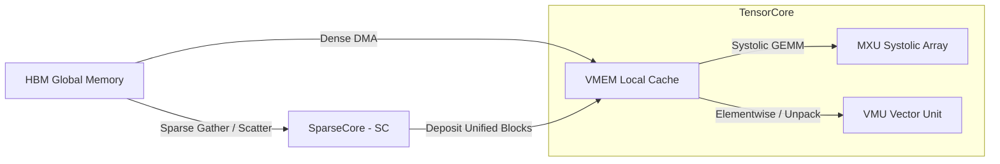

# Google TPU Hardware Architecture: TensorCore vs. SparseCore

To maximize hardware utilization, modern TPU v5 through v7 chips separate execution pathways onto two specialized hardware cores operating in parallel: the **TensorCore (TC)** and the **SparseCore (SC)**.

---

## 1. The TensorCore (TC)
The TensorCore is the compute engine of the TPU, optimized for highly structured, dense, and contiguous array calculations. It is a compute-bound processor.

### 1.1 Key Hardware Units
*   **Matrix Multiply Unit (MXU):** Systolic execution arrays designed to perform high-throughput matrix dot-products (GEMMs).
*   **Vector Multiply Unit (VMU):** Performs elementwise math (addition, activation scaling), transposes, normalizations (such as LayerNorm and RMSNorm), and software-based dequantization unpacking (e.g. unpacking FP4 weight blocks in registers).

### 1.2 Memory Model
*   The TensorCore VMU/MXU cannot directly query global memory (HBM) using index vectors.
*   Data must be loaded as contiguous, aligned blocks into a local, ultra-fast scratchpad memory called **VMEM** (Vector Memory, typically 16MB per core) using DMA channels.

---

## 2. The SparseCore (SC)
The SparseCore is a specialized memory co-processor designed for irregular, sparse, or unstructured gather and scatter lookup operations. It is a memory-bandwidth bound processor.

### 2.1 Architectural Motivation
In deep learning, operations like embedding lookup, Mixture of Experts (MoE) parameter gathering, or paged cache lookups require indexing non-contiguous lines of memory.
If the TensorCore performs these gathers, its MXU pipelines remain idle while waiting for high-latency HBM queries. The SparseCore operates in parallel to handle these lookups asynchronously.

### 2.2 Functional Execution
*   **Irregular Addressing:** Features custom address-generation hardware and crossbars to resolve non-contiguous indices directly against global HBM.
*   **Vector Accumulation:** Supports hardware-level vector accumulation (e.g., adding gradients directly to sparse memory addresses).
*   **Asynchronous Parallelism:** The TensorCore requests a gather from the SparseCore and continues executing dense math. The SparseCore loads, aligns, and deposits the gathered results directly into a VMEM page.

---

## 3. Comparative Summary

| Dimension | TensorCore (TC) | SparseCore (SC) |
| :--- | :--- | :--- |
| **Primary Bound** | Compute Bound (Maximize FLOPS) | Memory-Bandwidth Bound |
| **Data Layout** | Dense, aligned, contiguous arrays | Sparse, unstructured, scattered indices |
| **Core Components** | Systolic MXU array, Vector VMU | Address generation pipelines, Sparse crossbars |
| **Key Operations** | Matrix Multiplication (GEMM) | Gather, Scatter, Sparse Vector Accumulate |
| **Primary Memory** | VMEM (Local cache scratchpad) | Direct HBM (Global memory interface) |

---

## 4. Deep Learning Model Operations Mapping

| Model Layer / Operation | Execution Core | Processing Mechanics |
| :--- | :--- | :--- |
| **Dense GEMMs** (Query, Key, Value, Feed-Forward Projections) | TensorCore (MXU) | Multiplies dense parameters with activation states. |
| **Low-Precision Dequantization** (e.g. FP4 to FP8) | TensorCore (VMU) | Performs element-wise software unpacking inside VMEM before MXU dot-products. |
| **Embedding Lookups** | SparseCore (SC) | Gathers word representations from a huge vocabulary matrix. |
| **Mixture of Experts (MoE)** Routing/Gating | SparseCore (SC) | Gathers weights for active experts, and scatters outputs back to the token sequence. |
| **Paged Attention Cache Queries** | SparseCore (SC) | Resolves logical sequence indices to physical blocks in memory. |
