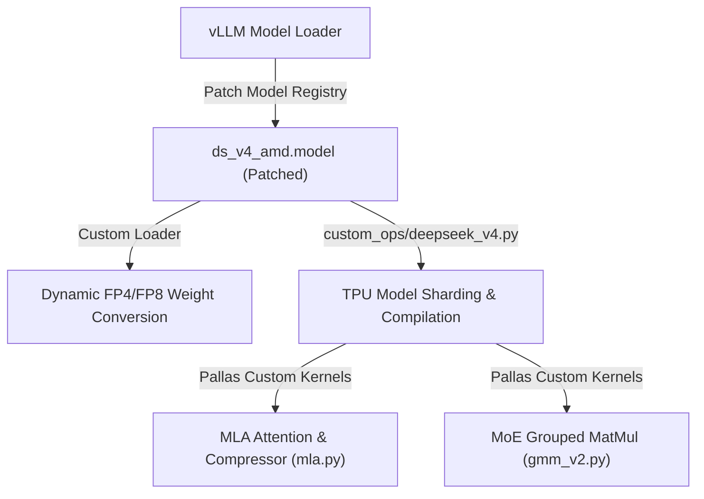

# DeepSeek-V4-Flash TPU Custom Operators & Model Patches

This directory contains the custom TPU operators and patching system designed to execute the **DeepSeek-V4-Flash** model on Google Cloud TPUs (TP=8, EP=8) via vLLM.

---

## 1. System Architecture

The implementation bridges standard vLLM execution with TPU-specific hardware acceleration by substituting GPU-centric classes and kernels with custom JAX/Pallas modules.



---

## 2. Component Directory

### Custom Operators (`src/vllm_torchtpu/layers/vllm/custom_ops/`)
*   **[deepseek_v4.py](file:///Users/patemotter/dsv4/torchtpu-vllm/src/vllm_torchtpu/layers/vllm/custom_ops/deepseek_v4.py):** Main custom op wrapper for the attention layer. Translates PyTorch calls into JAX execution via PyTorch-XLA's custom compilation bridge. Manages cache memory allocations and sharding specs under TP=8.
*   **[gdn_attention_op.py](file:///Users/patemotter/dsv4/torchtpu-vllm/src/vllm_torchtpu/layers/vllm/custom_ops/gdn_attention_op.py):** TPU-optimized implementation of Group-Query Attention variants.

### Custom Pallas Kernels (`src/vllm_torchtpu/kernels/`)
*   **[deepseek_v4/mla.py](file:///Users/patemotter/dsv4/torchtpu-vllm/src/vllm_torchtpu/kernels/deepseek_v4/mla.py):** Low-level custom Pallas kernel for Multi-Head Latent Attention. Directly computes block-quantized, paged attention for compressed FP8 key-value cache formats (448 FP8 values, 128 bytes RoPE keys, scales, and exponent bytes per slot).
*   **[deepseek_v4/mla_swa.py](file:///Users/patemotter/dsv4/torchtpu-vllm/src/vllm_torchtpu/kernels/deepseek_v4/mla_swa.py):** Custom Pallas kernel for Sliding Window Attention (SWA) layers.
*   **[deepseek_v4/streamindex_topk.py](file:///Users/patemotter/dsv4/torchtpu-vllm/src/vllm_torchtpu/kernels/deepseek_v4/streamindex_topk.py):** GPU-independent streaming Top-K index selection.
*   **[megablox/gmm_v2.py](file:///Users/patemotter/dsv4/torchtpu-vllm/src/vllm_torchtpu/kernels/megablox/gmm_v2.py):** TPU Grouped Matrix Multiplication (GMM) kernel executing Mixture-of-Experts routing over native FP4 weight tensors.

### Dynamic Weight Loader & Quantization (`src/vllm_torchtpu/layers/vllm/quantization/`)
*   **[mxfp4.py](file:///Users/patemotter/dsv4/torchtpu-vllm/src/vllm_torchtpu/layers/vllm/quantization/mxfp4.py):** Handles loading of MXFP4 weights, performing on-the-fly quantization of checkpoint values and converting scale factors to standard `ue8m0` exponents for GMM hardware acceleration.
*   **[fp8.py](file:///Users/patemotter/dsv4/torchtpu-vllm/src/vllm_torchtpu/layers/vllm/quantization/fp8.py):** Decodes scales using `is_scale_e8m0=True` parameter during dynamic FP8 quantization.

### Model Registry Patcher (`src/vllm_torchtpu/models/vllm/`)
*   **[deepseek_v4_patch.py](file:///Users/patemotter/dsv4/torchtpu-vllm/src/vllm_torchtpu/models/vllm/deepseek_v4_patch.py):** Context patcher applied during model loading:
    1.  Swaps the default CUDA model with the ROCm class structure (which allows cleaner custom layer injection).
    2.  Overrides model registry to load `VllmDeepseekV4MLAAttention`.
    3.  Bypasses GPU/CUDA stream/event checks.
    4.  Manually schedules FusedMoE weight processing.

---

## 3. Key Design Patterns

### Memory Profiling Safe Guards
During the vLLM memory profiling phase, key-value caches are passed to custom operators as empty size-`0` dummy tensors (e.g. `main_cache_kv.shape == (0,)`). 
All custom operators implement explicit shape-based early-return guards:
```python
if sw_cache.shape[0] == 0 or main_cache_kv.shape[0] == 0:
    # Build dummy outputs and trace fake dependencies to preserve lowered signature
    return dummy_out + dummy_sum, sw_cache + dummy_sum
```

### JAX SPMD Sharding Map Layout
Attention layers use JAX `shard_map` to execute model-parallel operations. Activations and parameters are sharded across the `ATTN_HEAD` and `model` (TP) mesh axes, matching vLLM's ColumnParallel and RowParallel layouts:
*   **Queries/Keys/Values:** Sharded along the head dimension: `P(ShardingAxisName.ATTN_HEAD, None)`
*   **Out Projection Weights ($W_{o,a}$, $W_{o,b}$):** Col-sharded / Row-sharded: `P(None, ShardingAxisName.ATTN_HEAD)`

---

## 4. Verification

### Verification Scripts
*   **[verify_dsv4.py](file:///Users/patemotter/dsv4/torchtpu-vllm/examples/verify_dsv4.py):** Launches the distributed vLLM engine, performs memory profiling, triggers JIT compilation, and runs a test generation pass.
*   **[verify_pipeline_parity.py](file:///Users/patemotter/dsv4/torchtpu-vllm/examples/verify_pipeline_parity.py):** Run-time activations comparison against upstream golden CPU reference.

### Launching on GKE
Execute the following to run the E2E verification on GKE (using real checkpoint parameters):
```bash
kubectl apply -f /mnt/workspace/torchtpu-vllm/dsv4-verify-v7x-8-patemotter.yml -n cloud-devkit-jobs
```
